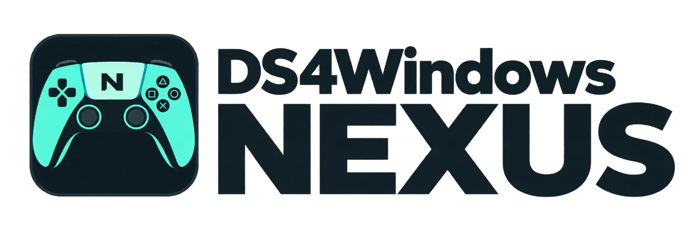
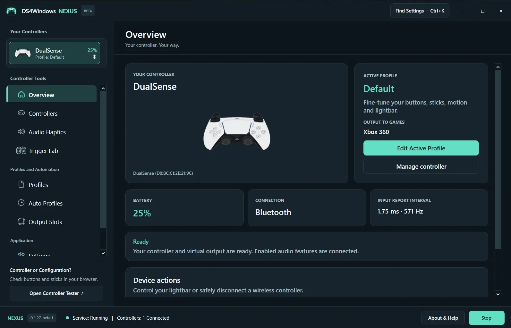

  <a href="https://ds4-windows.com/">
    <picture>
      <source media="(prefers-color-scheme: dark)" srcset="docs/images/nexus-logo-dark.webp">
      <source media="(prefers-color-scheme: light)" srcset="docs/images/nexus-logo-light.webp">
      
    </picture>
  </a>

<h1 align="center">DS4Windows Nexus</h1>

  <strong>Your controller. Your way.</strong> 
  Remap your gamepad, switch profiles per game, and tune DualSense feedback on Windows.

  <a href="https://github.com/emucores/DS4WindowsNexus/releases/latest"><strong>Download Nexus</strong></a>
  · <a href="https://ds4-windows.com/">Website</a>
  · <a href="https://ds4-windows.com/get-started/">Setup guide</a>
  · <a href="https://ds4-windows.com/changelog/">What’s new</a>
  · <a href="https://github.com/emucores/DS4WindowsNexus/issues">Report an issue</a>

  
  
  
  

## What Nexus offers

| Feature | What you can do |
| --- | --- |
| **Controller Overview** | See the active profile, battery, connection and input report rate in one place. |
| **Input mapping** | Remap buttons and sticks, tune deadzones and response curves, and configure touchpad gestures, gyro and special actions on supported devices. |
| **Per-game profiles** | Switch mappings automatically with Auto Profiles. Use the Game Setup Wizard, presets, profile history and backups to set up new games. |
| **Trigger Lab** | Tune linked or independent L2/R2 adaptive effects on DualSense and DualSense Edge. Preview feedback, weapon and vibration effects. |
| **Audio Haptics and lighting** | Turn system or per-app audio into grip feedback over USB or Bluetooth on DualSense and Edge. Adjust speaker or headset streaming, rumble, lightbar colours and player indicators. |
| **Guided setup and diagnostics** | Set up VIIPER and USBIP with restart recovery. Install optional HidHide and FakerInput, search settings, and check logs or controller health. |

  

## Download and install

Windows 10 build 19041 or later or Windows 11, x64. The compact package requires the Microsoft .NET 10 Desktop Runtime (x64).

| Package | When to use it |
| --- | --- |
| [Windows x64 ZIP](https://github.com/emucores/DS4WindowsNexus/releases/latest/download/DS4Windows-Nexus-x64.zip) | You already have the .NET 10 Desktop Runtime. Extract the entire folder and run `DS4Windows.exe`. |
| [First-run bundle](https://github.com/emucores/DS4WindowsNexus/releases/latest/download/DS4Windows-Nexus-x64-First-Run.zip) | You need the runtime installer. Extract the entire folder and run `First Run.cmd`. |
| [Matching source ZIP](https://github.com/emucores/DS4WindowsNexus/releases/latest/download/DS4Windows-Nexus-Source.zip) | Full application source and build files for the published release. |
| [SHA-256 checksums](https://github.com/emucores/DS4WindowsNexus/releases/latest/download/SHA256SUMS.txt) | Verify the ZIP you downloaded. |

**Updating?** Close Nexus, back up your profiles, and extract the new package into a fresh folder. Existing profiles and working drivers can be reused. Windows packages are currently unsigned.

## Controller compatibility

Nexus can present a virtual **Xbox 360, DualShock 4, DualSense or DualSense Edge** controller through VIIPER and USBIP. See the [controller compatibility guide](https://ds4-windows.com/supported-controllers/) for physical devices, connection options and feature coverage. DualSense Edge adaptive effects require the rear trigger stops set to full travel. Audio Haptics and Trigger Lab drive the physical controller locally. Virtual audio and microphone endpoints and advanced native game-trigger passthrough are outside the current feature set.

## Support, source and license

- [Setup and troubleshooting](https://ds4-windows.com/troubleshoot/)
- [GitHub issues](https://github.com/emucores/DS4WindowsNexus/issues) for bugs and feature requests. Include your Nexus version, Windows version, controller model, USB or Bluetooth, and steps to reproduce.
- [Latest release notes](https://github.com/emucores/DS4WindowsNexus/releases/latest) and the [website changelog](https://ds4-windows.com/changelog/).

Nexus is maintained by [EmuCores](https://github.com/emucores) and builds on [hbashton/DS4Windows](https://github.com/hbashton/DS4Windows) and the wider DS4Windows community. The application and Nexus modifications are distributed under [GPL-3.0-or-later](LICENSE). Download **DS4Windows-Nexus-Source.zip** from the release assets for the complete matching source and third-party notices.
