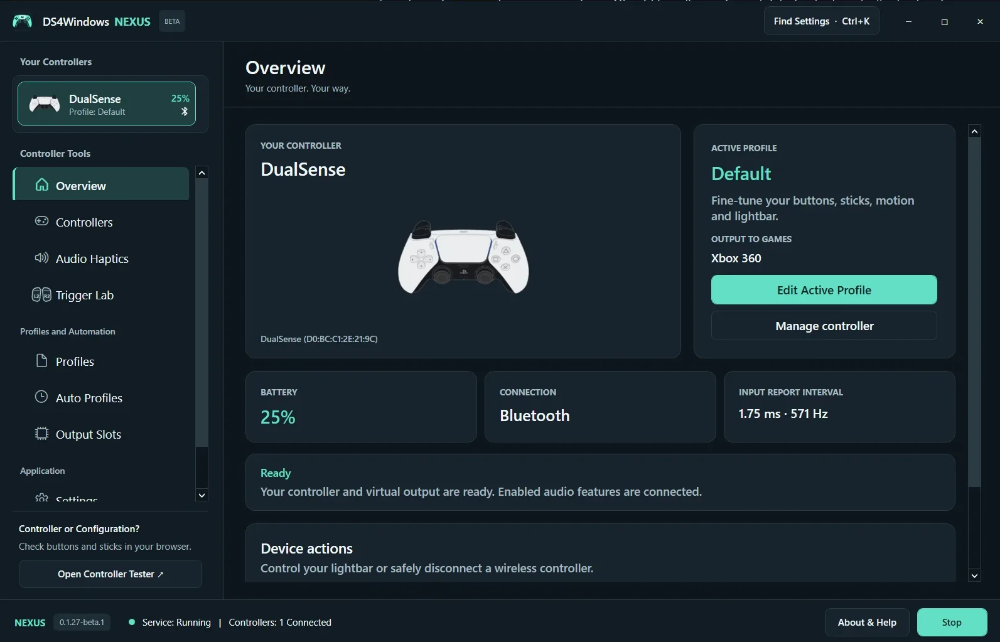
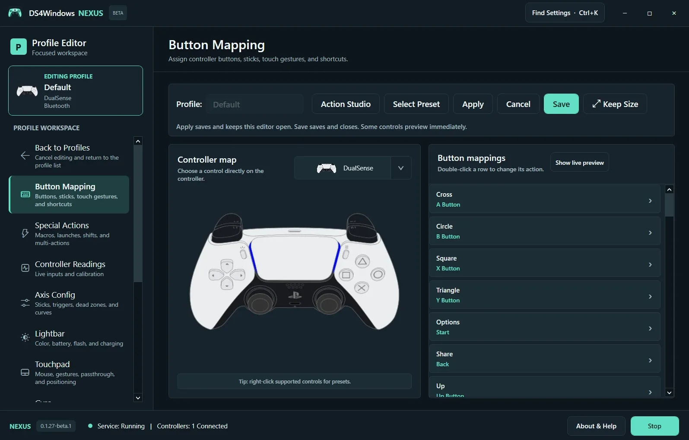
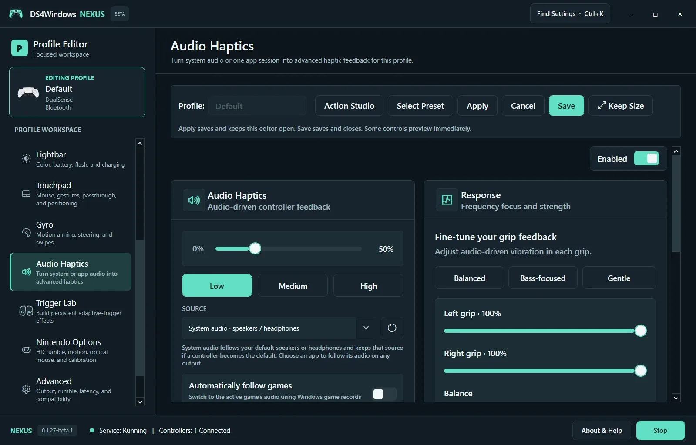

# DS4Windows Nexus

**Your controller. Your way.**

DS4Windows Nexus is an open-source gamepad input mapper and virtual controller emulator for Windows 10 and Windows 11. Connect a supported PlayStation controller, customize its controls and present a virtual controller that your game understands.

[Website](https://ds4-windows.com) · [Getting started](https://ds4-windows.com/get-started/) · [Documentation](https://ds4-windows.com/docs/) · [Controller compatibility](https://ds4-windows.com/supported-controllers/) · [Report an issue](https://github.com/emucores/DS4WindowsNexus/issues)

## V1.0 Beta

This is the first Nexus release, for **Windows x64**. [Download the Windows x64 ZIP](https://github.com/emucores/DS4WindowsNexus/releases/download/v1.0.0-beta.1/DS4Windows-Nexus-V1.0-Beta.zip) or read the [release notes](https://github.com/emucores/DS4WindowsNexus/releases/tag/v1.0.0-beta.1).

The complete package includes the app, its .NET runtime, matching source and notices. Extract the full archive; do not move only the executable. Screenshot version labels may show earlier development builds.

## Inside Nexus

- **Customizable workspace:** controller status, profile editing, searchable settings and live readings.
- **Mapping and profiles:** buttons, sticks, curves, deadzones, touchpad actions, macros and application-based Auto Profiles.
- **Motion controls:** gyro aiming, steering and motion-driven mouse control on supported hardware.
- **Audio Haptics:** translate system or app audio into controller feedback, with response and grip tuning.
- **Trigger Lab:** create linked or independent adaptive-trigger effects for supported DualSense and DualSense Edge controllers.
- **Guided setup and diagnostics:** controller selection, system checks, input testing, logs, backups and recovery tools.
- **Virtual output:** use the supported VIIPER / USB-IP configuration for Xbox 360, Xbox One / Series, DualShock 4, DualSense, DualSense Edge or Switch 2 Pro output.

A virtual controller is the software-created device presented to games. It can differ from the physical controller in your hands. Selecting an output does not add missing hardware capabilities; game, controller and connection support still matter.

**DS4Windows and DS5Windows refer to the same Nexus package.** A separate application is not required just because you use a PS5 controller.

## Screenshots

### Controller overview

### Profile editor

### Audio Haptics

Screenshots show the Nexus interface. Settings shown are examples, not recommendations for every controller.

## Get started

1. Download the Windows x64 archive from Releases and extract all files.
2. Open Nexus and follow controller selection and system checks.
3. Configure VIIPER / USB-IP when virtual output is required. Use HidHide when needed to prevent double input.
4. Connect your controller using a data-capable USB cable or Windows Bluetooth pairing.
5. Select the controller, create a profile and choose the virtual output your game expects.
6. Test buttons and sticks, then test feedback separately before playing.

Follow the [illustrated setup guide](https://ds4-windows.com/get-started/) for connection details and troubleshooting. Back up existing profiles before trying the beta.

## Beta status

The Windows x64 build and 170 automated tests passed during preparation. Windows UI, fresh-PC driver installation, restart behavior and physical controller feedback still need hands-on acceptance testing. The beta is unsigned and uses manual downloads; automatic online updates are not enabled. Do not interpret automated tests as a hardware compatibility guarantee.

## Support

For reproducible app bugs, [open a GitHub issue](https://github.com/emucores/DS4WindowsNexus/issues) with your controller model, USB/Bluetooth connection, Windows version, Nexus version, selected virtual output, expected behavior and reproduction steps. Remove personal information from logs before sharing.

For website or general support, use [the contact page](https://ds4-windows.com/contact-us/) or email **support@ds4-windows.com**.

## Project history and credits

Nexus is maintained by **EmuCores** and builds on the work of the DS4Windows community, including Jays2Kings, Ryochan7 and hbashton. The Nexus workspace and guidance build on that foundation; inherited mapping, controller and feedback capabilities are credited to their original contributors.

This is an independent project, not affiliated with Sony or Microsoft. Product names belong to their respective owners. The release package includes matching GPL source and original license notices; retain them when redistributing.
